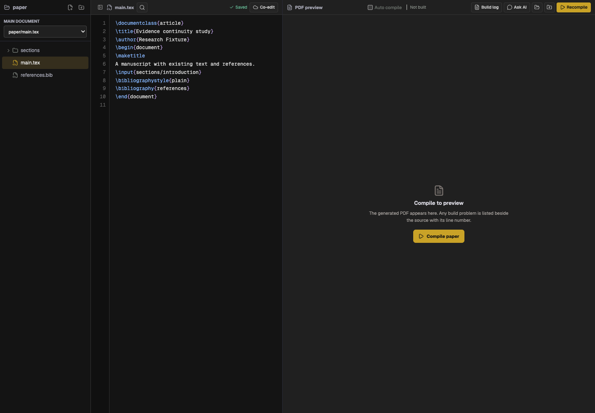
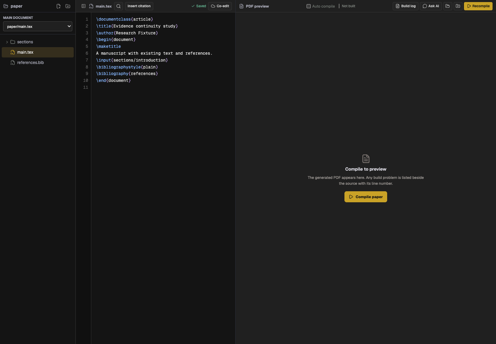
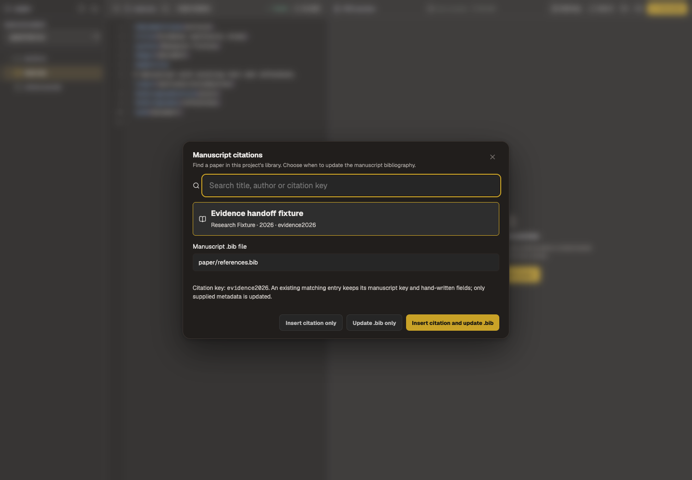
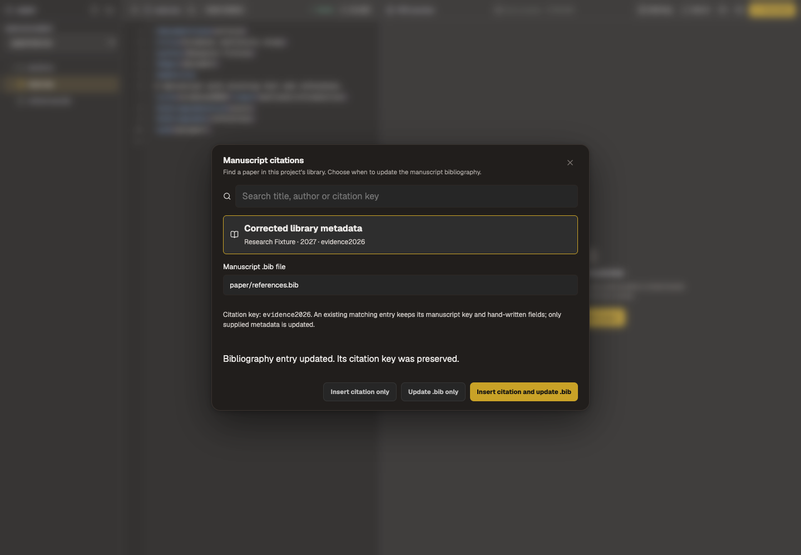

# Manuscript reference evidence

`before.png` and `after.png` are direct 1440×1000 browser content captures,
using the same Charcoal theme, English language and synthetic main/section/
bibliography files. Before runs the actual prerequisite base `ff5f0c4`
(existing-manuscript and bibliography-interchange changes); after runs this
branch. Both show the saved main document with auto compile off and no build.
The added **Insert citation** toolbar action is the visual difference.

`dialog.png`, `inserted.png` and `updated.png` show the new dialog and its normal
actions. The fixture uses a real filesystem and SQLite project library via a
local desktop-bridge harness, not a fabricated completed product result.
After **Insert citation and update .bib**, the fixture's library title and year
were corrected through the existing metadata API, then **Update .bib only**
retained `evidence2026` and the one existing citation. The handwritten book entry
and its note remained intact. The dialog copy uses one key/preservation hint.

The actual **Recompile** action subsequently succeeded with the managed
Tectonic engine and existing cache (342 ms on this small fixture). Its PDF was
17,078 bytes, SHA-256
`17bd7a6112eb8b8916811bbc3280b0750af317dab2d9b6a5cbeccaa155f4b13f`.
This renderer harness checks the real compile result and output file; it does
not emulate Electron's PDF URL handler.

## Keep bibliography annotations and external edits

These captures use the compiled macOS Electron app in the Charcoal theme at
1560 × 980. In two temporary workspaces, the same manuscript entry starts with a
handwritten DOI comment. Update its metadata, append a new reference to the
saved bibliography from outside Writing, update the original metadata again,
and open `references.bib` in Writing. The old build (`e8b8c1e`) loses both manual
changes. The new build (`260dbb0`) keeps both and preserves `fixture2026`.

| Before | After |
| --- | --- |
| [Bibliography after two updates](bibliography-refresh-before.png) | [Bibliography keeps the DOI note and added entry](bibliography-refresh-after.png) |

## Citation keys across bibliography files

The main document declares `\bibliography{refs,other}` and already cites
`shared` from `other.bib`. These matched 1560 × 980 Electron captures show
inserting a library paper with the same suggested key into `refs.bib`. The old
build (`bf2dc23`) reused `shared`. The fix allocated `shared_2`, preserving the
old `\cite{shared}` and leaving `other.bib` byte-for-byte unchanged.

An offline Tectonic/BibTeX comparison used the same roman fallback in both
fixtures because the italic font was outside the local cache. The old BibTeX
log reported a repeated entry and skipped the original book. The fixed fixture
compiled with two bibliography items, `shared` for the original book and
`shared_2` for the inserted paper, with no repeated-entry warning.

| Before | After |
| --- | --- |
| [Two citations used the same key](multiple-files-before.png) | [The inserted citation has its own key](multiple-files-after.png) |

## Citation actions during Co-edit

These matched 1560 × 980 Charcoal captures use the compiled Electron app and
its actual Y.Text editor, with an in-memory stand-in for the cloud transport.
In the old build (`4a66519`), insertion reached the local file but the next
shared edit saved it away. In the updated dialog, adding a citation requires
leaving Co-edit. Updating `.bib` metadata remains available and the local main
file keeps its original bytes. Both citation insertion actions return when
Co-edit is turned off.

| Before | After |
| --- | --- |
| [Insertion is offered while editing shared text](coedit-before.png) | [Only the bibliography update is available in Co-edit](coedit-after.png) |
