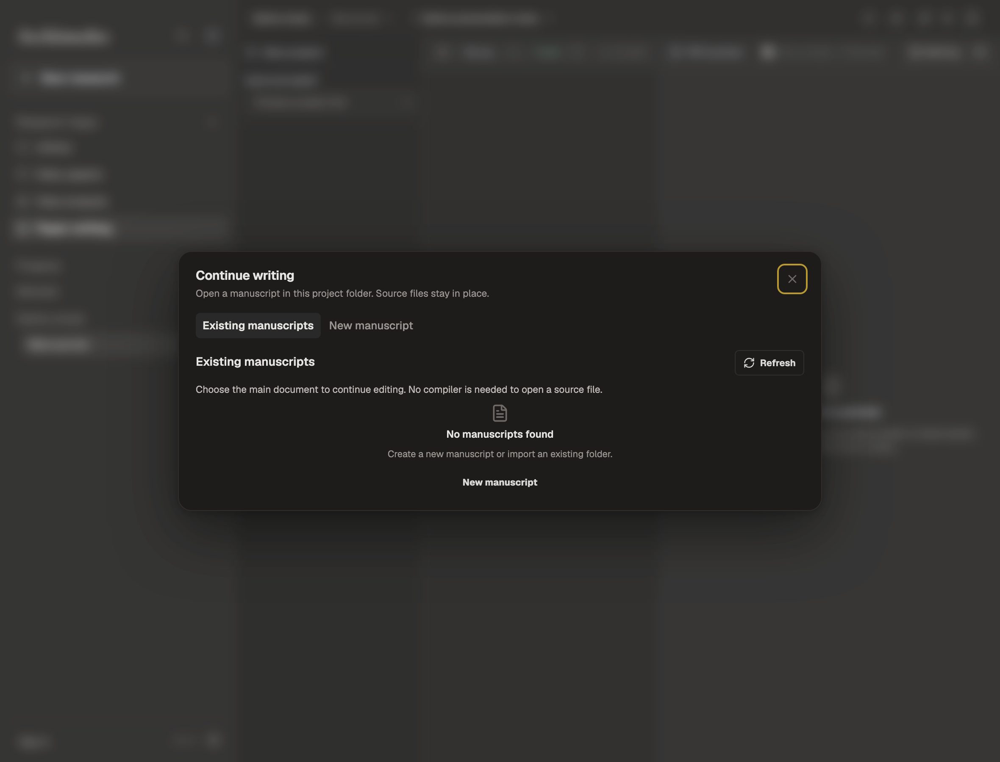
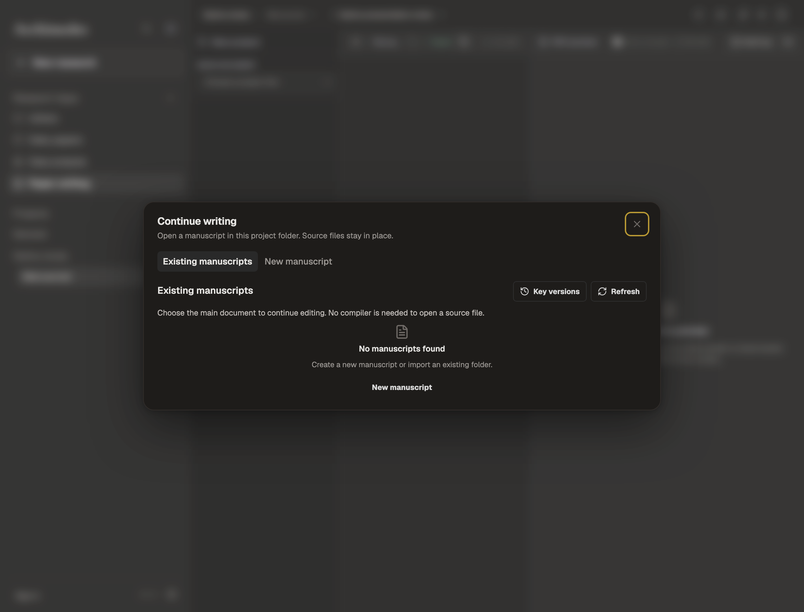
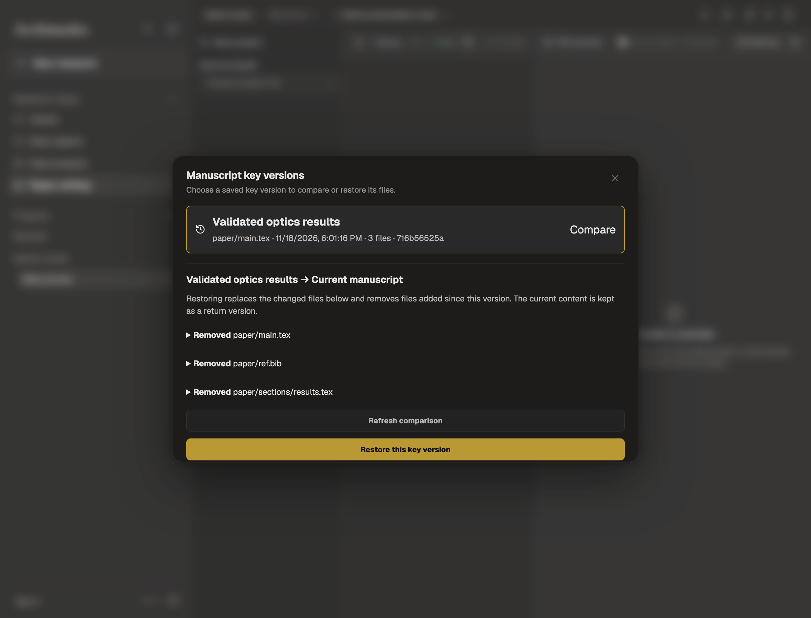
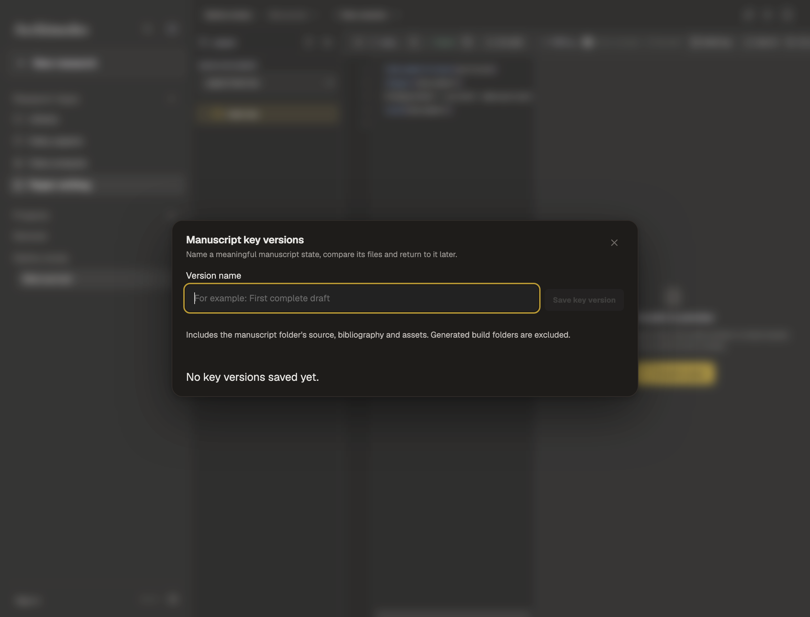
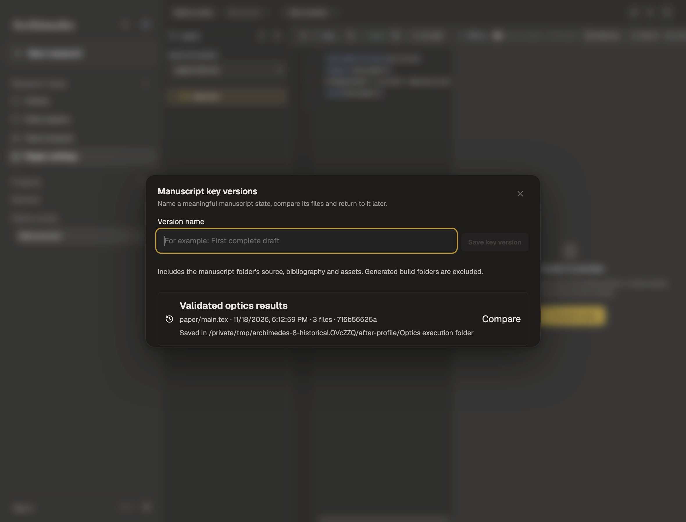
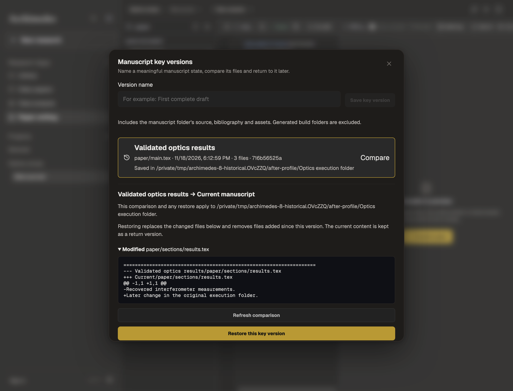

# Manuscript key versions evidence

Both images render the actual `PaperWritingView` at 1440×1000, Charcoal and
English, with the same single-file manuscript and controlled bridge fixture.

- `before.png` uses the prerequisite base `ea87334`: the Writing toolbar has no
  key-version action.
- `after.png` uses this PR: **Key versions** opens the actual dialog, saves
  "First complete draft", then compares it with a changed `main.tex`. The
  dialog shows the added line, its diff and the restore action.

The bridge returns a deterministic file list and version record for the
capture; save/compare/restore against real filesystem bytes, SQLite ownership
and command handlers are covered by `electron/paper-writing-history.test.cjs`
and the focused Writing component test.

## Restore recovery

The compiled Electron app was exercised with the same temporary three-file
manuscript in Charcoal at 1560 × 980. The before build is `284a151` and the
after build is `79196dc`. Both runs used the normal Writing toolbar, comparison,
and restore buttons with real local persistence.

| Action | Before | After |
| --- | --- | --- |
| Compare after renaming `main.tex` | [Comparison failed](missing-main-before.png) | [Comparison shows the missing main file and allows restore](missing-main-after.png) |
| Restore after replacing `z.tex` with a directory | [Restore failed after writing the earlier file](path-transition-before.png) | [Restored main and methods, with a return version](path-transition-after.png) |

The source-tree pair uses the same Charcoal viewport and an expanded `sections`
folder after restoring a version. Both builds restore the correct bytes on disk.
The earlier build (`8dcff12`) leaves `current.tex` in the Writing tree, and the
fixed build (`c8b8e58`) shows and opens the restored `restored.tex` immediately.

| Before | After |
| --- | --- |
| [Stale entry in expanded folder](source-tree-before.png) | [Restored section visible in the same folder](source-tree-after.png) |

## Recover after restarting with no manuscript files

Both production Electron builds saved **Validated optics results** through the
Writing dialog, then quit. The sample manuscript directory was moved out of
the execution folder while the app was closed. Both captures show the same
freshly opened Writing chooser at 1,180 × 900 in Charcoal.

| Before (`049b3b2`) | After (`97b5a88`) |
| --- | --- |
|  |  |

In the fixed build, choosing **Key versions** reveals the saved name and
`paper/main.tex`. The comparison shows the three missing files. After restore,
Writing opens the main file and the main file, section, and bibliography on
disk match their original contents.

## Recover a key version from an earlier project folder

Both production Electron builds saved **Validated optics results** without a
chat. The project's default execution folder then moved to another folder
with its own `paper/main.tex`. After restart, both builds opened that new
manuscript and its **Key versions** dialog at 1,180 × 900 in Charcoal.

| Before (`ccb125f`) | After (`187b004`) |
| --- | --- |
|  |  |

The restored line belongs to the manuscript in the original folder. The
current editor and its source retain their own contents.

