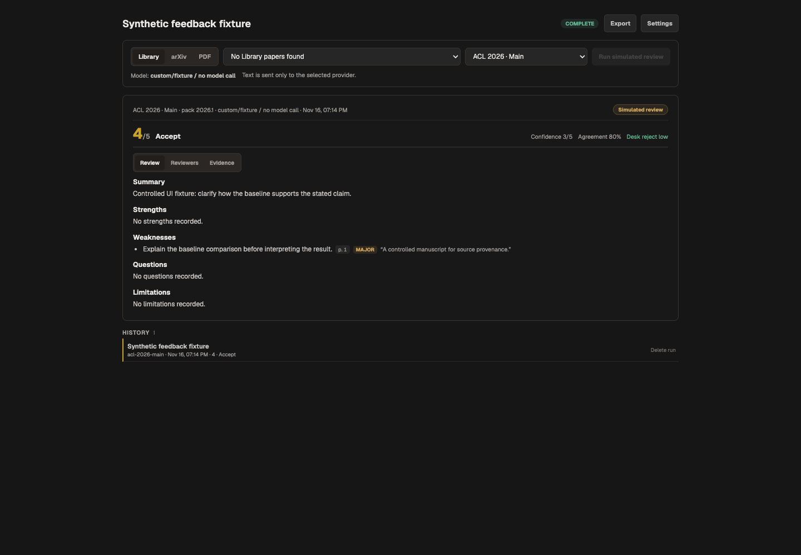
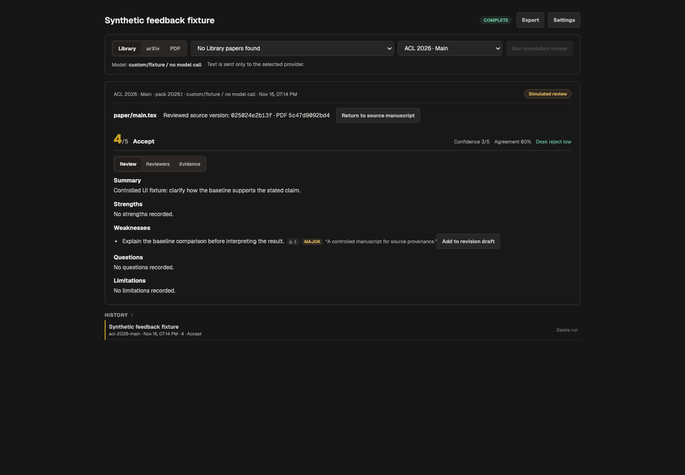
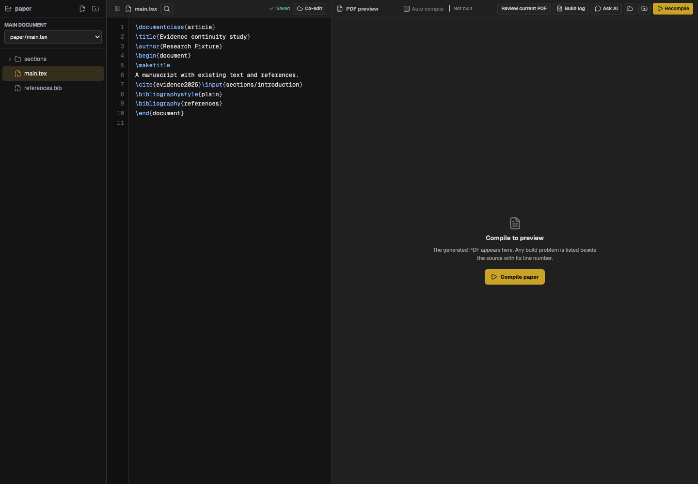

# Manuscript review and revision evidence

All captures are direct 1440×1000 browser content screenshots in Charcoal,
using the actual renderer components and local filesystem/SQLite adapters.
The prerequisite base is `codex/manuscript-review-base`; the feature uses the
same saved state for each before/after pair.

- `before.png` / `after.png`: the same completed **Synthetic feedback fixture**
  row. Its feedback was seeded into the real review database for layout
  inspection; no model review was run. The feature shows the recorded source
  version/PDF hash, return action and selected-finding revision action.
- `writing-before.png` / `writing-after.png`: the same saved multi-file paper,
  auto compile off, no active build. The feature adds **Review current PDF**.
- `prepared-source.png`: the new prepared-source state. Its PDF and source
  manifest came from a real managed Tectonic compilation (322 ms with the
  existing cache). The synthetic feedback fixture is separate from this
  source-preparation observation.

Behavior tests execute the actual App revision/return callbacks against real
project/thread records: selected evidence is appended to an independent
revision discussion, the original unsent draft survives, and returning opens
the recorded source file/root. Backend tests create real review rows with
controlled PDF/model dependencies, retain their actual build IDs, and verify
that explicit deletion releases only that review's reference even after the
manuscript sources are removed. Another consumer's retained input survives.

