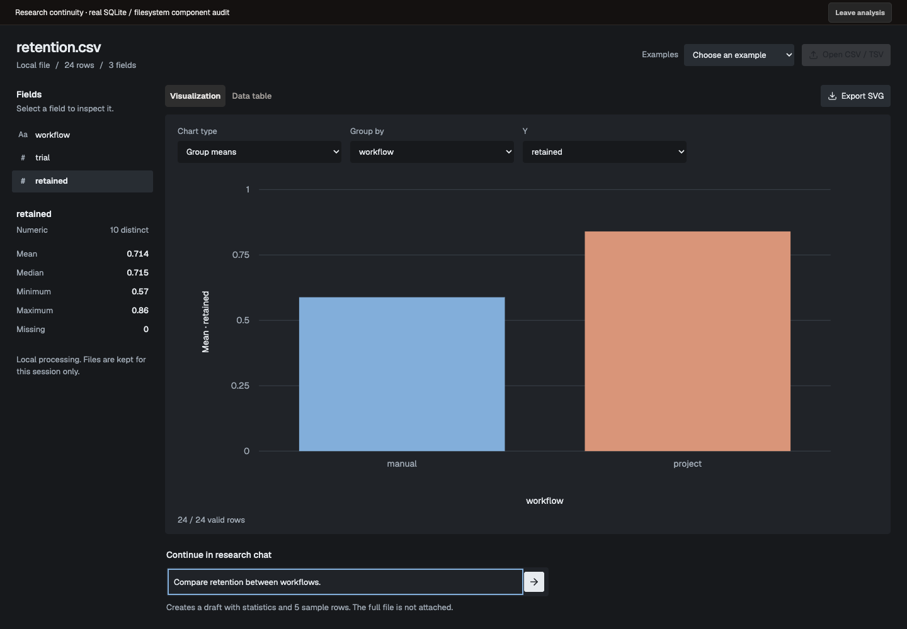
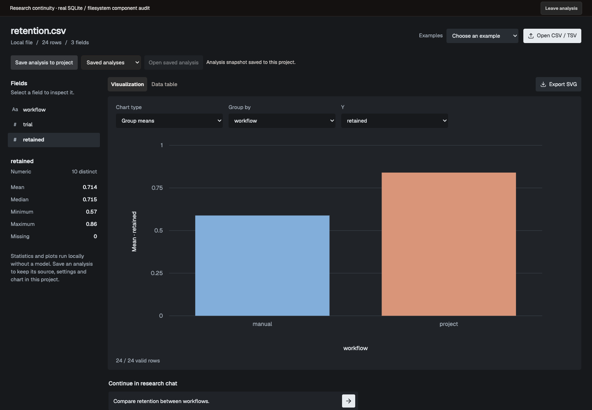
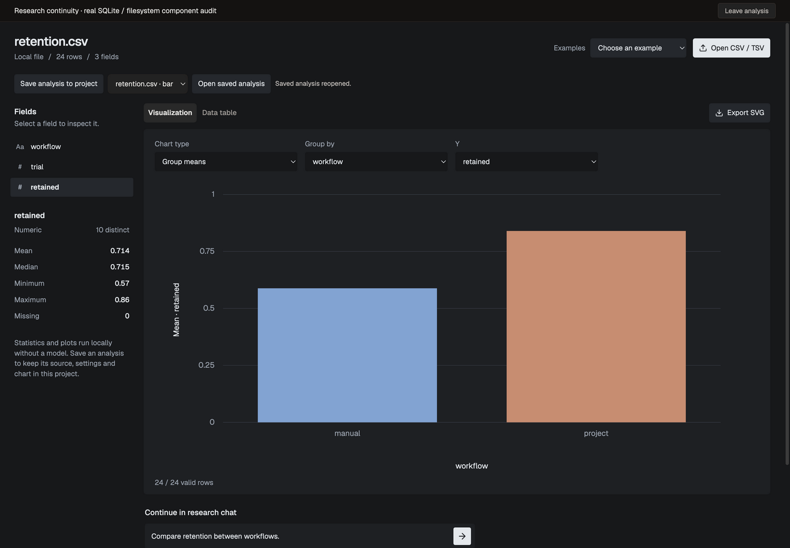

# Project analysis persistence evidence

The images show the actual `DataAnalysisView` component at 1440×1000, Charcoal,
English and default text size. Before uses the actual prerequisite base
`9a879c6` (session draft/owner changes); the final review base `1cb5bb9` adds
only late-attachment ownership and does not change the analysis view. After
uses this PR's feature code.
Both load the same synthetic `retention.csv`: 24 rows, three fields, group means
by `workflow` with `retained` on Y, and the same typed question. The narrow header
identifies the component audit and its controls; it is not a new product header.

| Before | After saving |
| --- | --- |
|  |  |

The renderer adapter delegates the new result API to the actual project-result
commands, SQLite store and filesystem. No production preview persistence was
added. After saving, the view was unmounted, its real database connection closed
and reopened, then **Open saved analysis** restored the original source,
configuration and question. `reopened.png` shows that completed return journey.
The complete 376-byte source matched the original CSV byte for byte, with SHA-256
`e30cf5b8ae34a831057dd91253fa4726876709e8bf035a3c8810b49dc27f3913`.
The persisted SVG and source receipts were both `ready`.

Actual App callback tests separately cover the discussion handoff, including
another task/data folder being selected while creation is pending. Component
and real-bridge tests also verify that associating the discussion preserves the
saved source/configuration/SVG and the other dataset's working draft.
