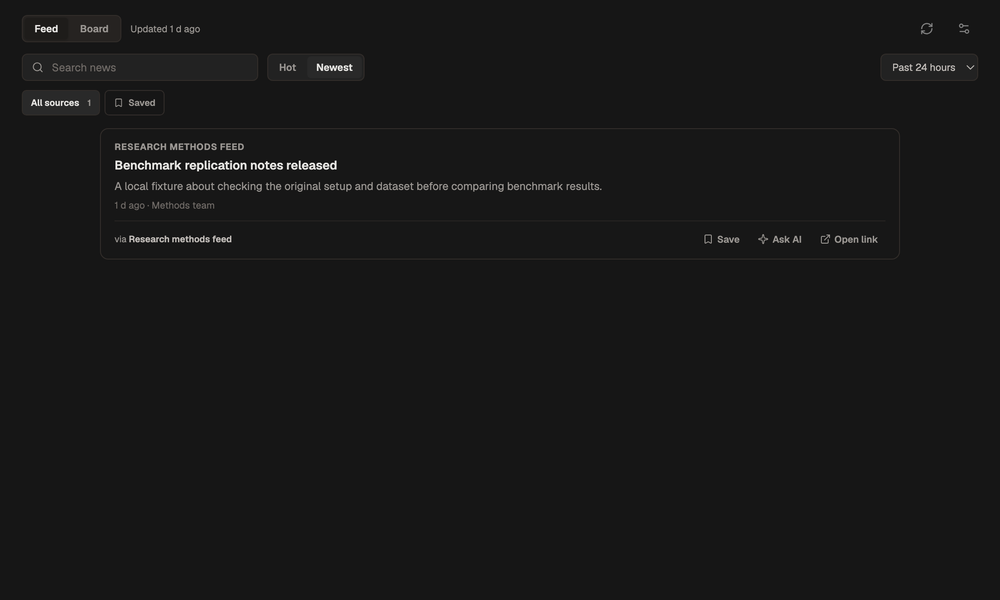
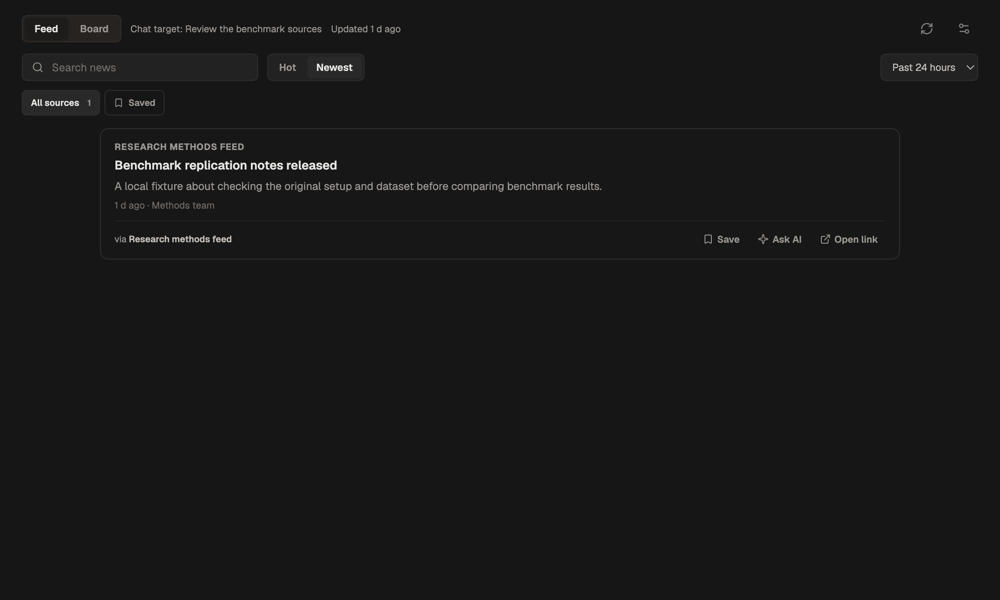
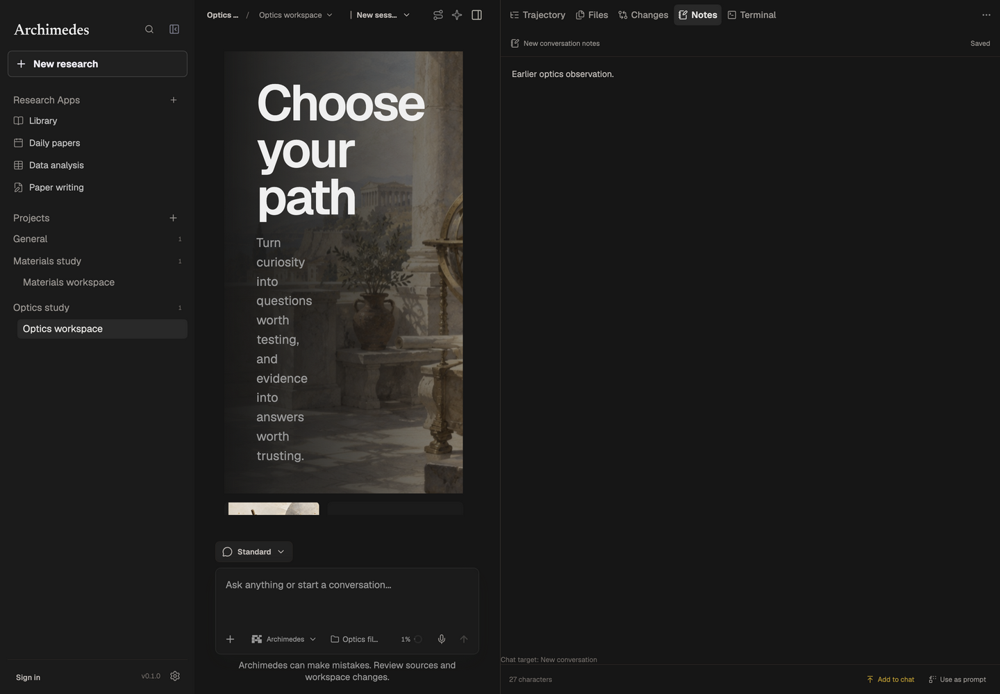

The Notes/composer pair uses the actual renderer at 1440 × 1000, charcoal, English, default text size, a 640-pixel workbench, and the same deterministic preview project. Before is upstream main `1f4b375` (the same Notes/News/composer layout as the task-context review base); after is this feature. Both views start with the same existing prompt and note and invoke Add to chat through the UI. The after view names the target chat. Asynchronous owner and persistence differences are demonstrated by the real callback/component and filesystem tests reported in the PR.

The News pair renders the actual News view in Electron at 1100 × 660, Charcoal and English. Both captures use the same fixed local feed and the conversation **Review the benchmark sources**. The before view uses the review base at `8bce856`. The after view names the conversation beside the Feed and Board controls. Clicking **Ask AI** in the after view appends the fixture article to the configured chat callback.

| Before | After |
| --- | --- |
|  |  |

## Note autosave during a workspace switch

Both captures show the Electron Notes panel in Charcoal at 1440 × 1000. After an edit in an empty Optics conversation, the user switched to Materials and back within 110 ms. The normal note debounce is 600 ms.

Before at `585e5b1`, returning to Optics reloaded the earlier note. With the fix in `e13e76f`, the new Optics text stayed visible and was saved. A read of the stored notes confirmed that the Materials note retained its own text.

| Before | After |
| --- | --- |
|  |  |
