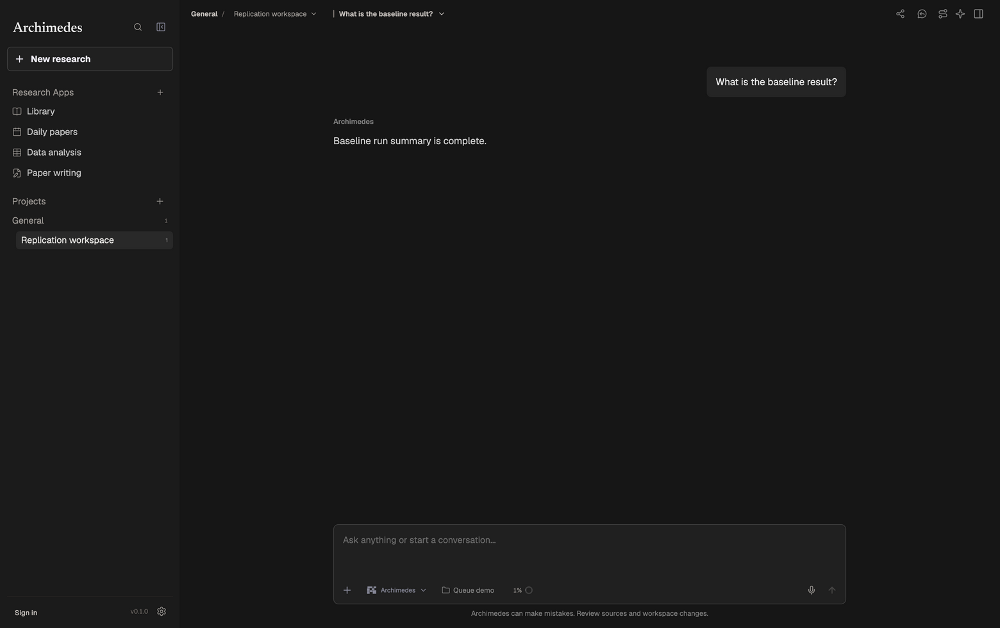
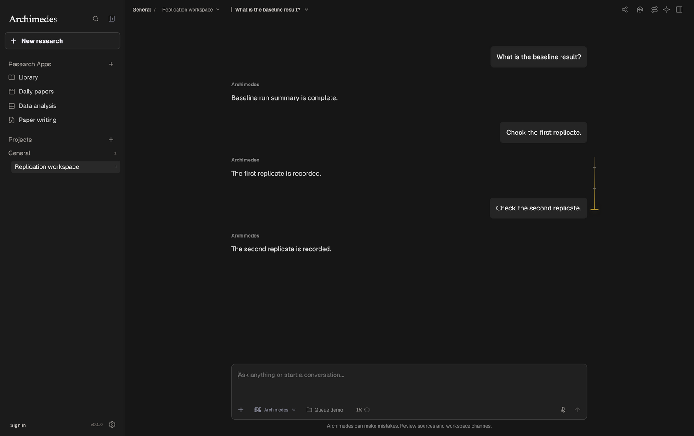

# Queue during a new conversation

Both screenshots show Electron in the Charcoal theme at 1560 × 980. A loopback model streamed the first answer and waited while two follow-ups were queued using Enter. Both builds showed two queued messages before the first answer finished.

| Build | Requests received by the model | User messages saved in the conversation |
| --- | --- | --- |
| PR base `166e93cb` | Initial question, first follow-up, second follow-up | All three in order |
| Before `04366d03` | Initial question only | Initial question only |
| After `b0bd3c0` | Initial question, first follow-up, second follow-up | All three in order |

Before, the first result opened the new conversation and the two follow-ups disappeared.

After, both follow-ups ran in order and their replies appeared in the same conversation.

