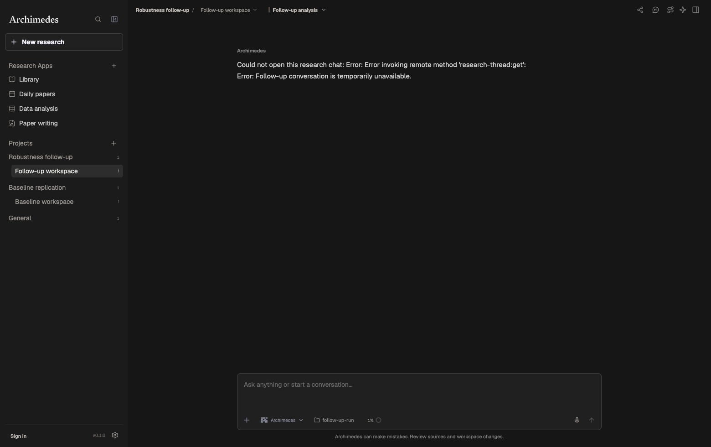
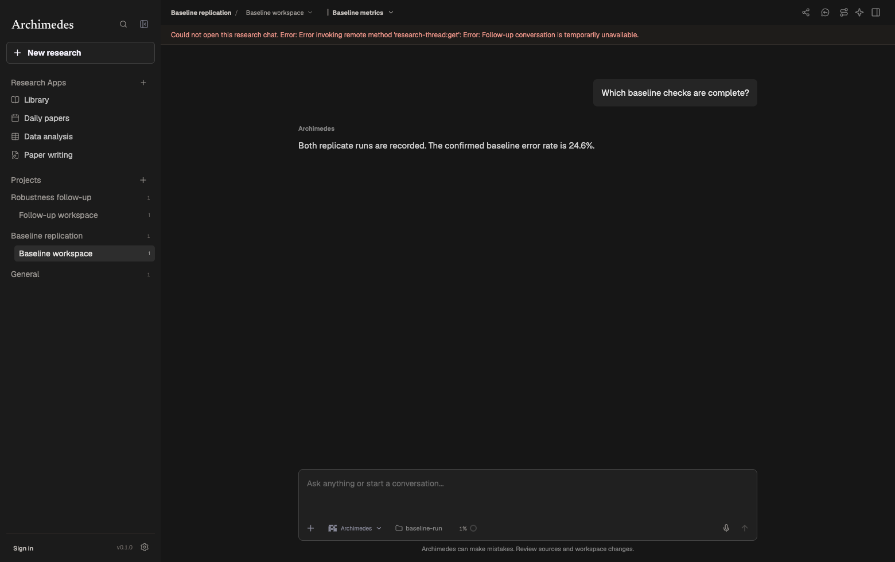

# Failed task selection

Both screenshots show the production renderer in Electron with the Charcoal theme at 1560 × 980. Each run opens the same synthetic Baseline metrics conversation and then selects Follow-up workspace from the sidebar. The read of the follow-up conversation fails after 450 ms in both builds.

Before (`166e93cb`), the follow-up workspace becomes active and the read error replaces the original transcript with an assistant message.

After (`b955e257`), the baseline workspace and its transcript stay active. A visible alert beneath the toolbar reports the failed open.

