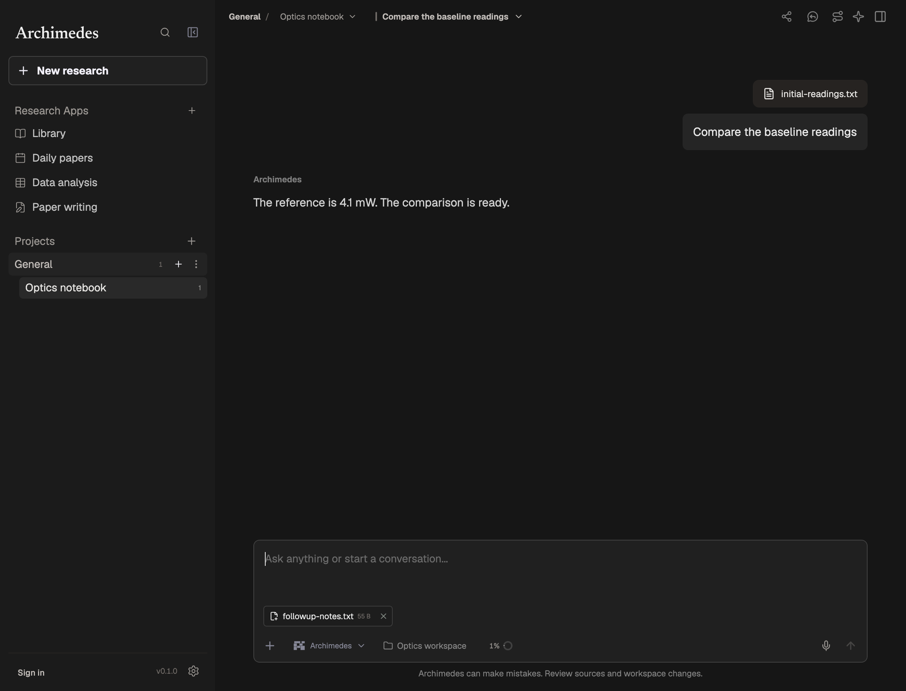
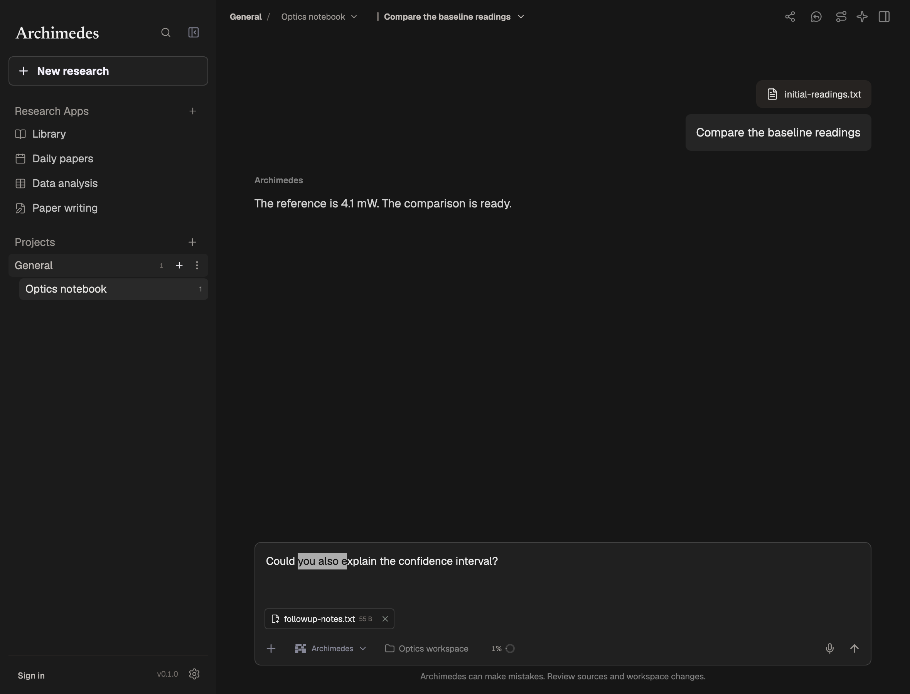

# Unsent follow-up during the first reply

Both production Electron runs use a 1,180 × 900 Charcoal viewport. From **New
research**, send an initial question and a local file. A loopback model
streams the start of the reply and pauses. Type a follow-up and attach
`followup-notes.txt` using the same composer, then let the first reply finish.

| Before (`6416b452`) | After (`5bc3130`) |
| --- | --- |
|  |  |

Both runs made one model request. The initial file belongs to the first
message, and the later file remains attached to the unsent follow-up. The
fixed build preserves the follow-up text and selected range. A new task
starts empty, and reopening the saved conversation restores its draft.
A separate run switched to Library before the first reply finished; returning
to the saved conversation also restored its text.
